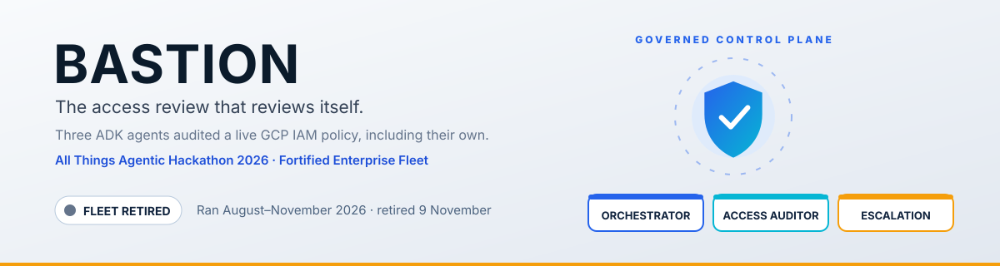

# Bastion

<p align="center">
  <picture>
    <source media="(prefers-color-scheme: dark)" srcset="assets/brand/banner-dark.svg">
    <source media="(prefers-color-scheme: light)" srcset="assets/brand/banner-light.svg">
    
  </picture>
</p>

<p align="center">
  <strong>Three institutional agents. One durable investigation identity. No raw IAM binding crosses the model or human-notification boundary.</strong>
</p>

<p align="center">All Things Agentic Hackathon 2026 · Fortified Enterprise Fleet</p>

<!-- Row 1 — repository state. Same five as the sibling repositories, same order.
     Nothing may be inserted between these badge lines: a comment breaks the paragraph and
     drops the badge after it onto a row of its own. -->
[](https://github.com/iarjunganesh/bastion/actions/workflows/ci.yml)
[](https://codecov.io/gh/iarjunganesh/bastion)
[](https://github.com/iarjunganesh/bastion/releases/latest)
[](LICENSE)
[](https://youtu.be/Xpj8YmzFfpk)

<!-- Row 2 — what Bastion is actually built on, plus the program badge earned before it. -->
[](https://google.github.io/adk-docs/)
[](https://github.com/a2aproject/a2a-python)
[](https://developers.google.com/profile/badges/community/gear?u=iarjunganesh)

<!-- Row 3 — the seven GEAP pillars, six of them managed products rather than modules here. -->
[](https://docs.cloud.google.com/gemini-enterprise-agent-platform/scale)
[](https://docs.cloud.google.com/gemini-enterprise-agent-platform/scale/runtime/agent-identity)
[](https://docs.cloud.google.com/gemini-enterprise-agent-platform/govern/gateways/agent-gateway-overview)
[](https://docs.cloud.google.com/gemini-enterprise-agent-platform/govern/agent-registry)
[](https://docs.cloud.google.com/gemini-enterprise-agent-platform/scale/memory-bank)
[](https://docs.cloud.google.com/model-armor/model-armor-vertex-integration)
[](https://docs.cloud.google.com/gemini-enterprise-agent-platform/optimize/observability/overview)

<!-- Row 4 — the rest of the deployed surface. -->
[](https://cloud.google.com/run)
[](https://cloud.google.com/eventarc)
[](https://cloud.google.com/firestore)
[](https://cloud.google.com/asset-inventory/docs)
[](https://cloud.google.com/vertex-ai)

<!-- Row 5 — language and toolchain. check_badge_versions() asserts these against the pins. -->
[](https://www.python.org/)
[](https://docs.astral.sh/ruff/)
[](https://mypy-lang.org/)
[](https://docs.pytest.org/)
[](https://vercel.com)

<!-- Row 6 — the public evidence console's own live hosting. The operational fleet stays on GCP;
     this is the presentation plane only, per the "public evidence console" note below. -->
[](https://bastion.arjunganesh.dev)

---

## What it does

Bastion reviews the real IAM policy of the GCP project that runs it, using read-only Cloud Asset
Inventory. Deterministic code flags Owner/Editor grants, scores them, applies human exceptions
and routes reviews. Gemini writes a bounded rationale; it does not decide risk or delivery.
Raw members, roles, resources and bindings stay inside the Auditor's deterministic tool.
The minimised schema carries opaque IDs, departments, categories and scores, not an anonymity
or general zero-leakage guarantee.

## Request path

<p align="center">
  <picture>
    <source media="(prefers-color-scheme: dark)" srcset="assets/architecture/governed-investigation-flow-dark.svg">
    <source media="(prefers-color-scheme: light)" srcset="assets/architecture/governed-investigation-flow-light.svg">
    
  </picture>
</p>

Approved event → Pub/Sub/Eventarc → IAM-protected durable dispatcher → managed Agent Runtime →
Gateway/Registry/IAP → Access Auditor → deterministic policy step and gate → model-free
Escalation Agent → completion gate.

There are three institutional agents; the policy steps and gates are internal deterministic
steps. The dispatcher has no local agent graph or direct worker path. A2A workers validate the
deployment-owned origin credential; the findings API uses Cloud Run IAM. There is no public
agent demo endpoint. The separate [evidence console](https://bastion.arjunganesh.dev/) serves
static sanitised records and makes no request to the private fleet.

## Evidence and current state

The [claim matrix](docs/research/claim-matrix.md) bounds each claim; the
[evidence index](assets/README.md) records measurements and their limits.

- The dated August captures establish the governed route, identity separation, minimised real-IAM
  findings, screening, audit and trace observations. The inventory records 21 APIs and 39 resources;
  it is not a current health check.
- The [27 October pilot](assets/evidence/14-live-validation.md) shaped the pre-defined November
  cohort N. N ran on the unchanged August deployment and retained its false completion alongside
  a successful batch. It is not a reliability rate.
- On 5 November, both deployment surfaces were updated. The first F pilot failed closed on an
  Escalation routing parser ([E24](assets/evidence/24-upgraded-deployment-and-stopped-pilot.md)).
  Separately corrected recovery passed five normal cases, a direct confirmation control and two
  replays; the refusal join was verified read-only after a collector false positive
  ([E25](assets/evidence/25-corrected-cohort-F-verification.md)). The original stop is retained.
- The 6 November daily billing check passed for currently reported usage; exact per-chunk currency
  attribution and late postings remain bounded. Current balances and reservations stay private.
- [Version provenance](docs/VERSIONS.md) separates source pins, image assertions and unreadable
  Runtime installed packages. v0.8.0 remains the 28 October source release with its
  [accepted dependency advisory](docs/DEPENDENCY-STATUS.md).

The technical report is local in `report/`, uncommitted and outside the release. The final
14-page local edition and cited-source snapshot were prepared on 6 November. The agreed fleet end state remains 8–10 November,
dry run first; publication and site deployment are separate actions.

## A boundary failure worth testing

ADK session state does not cross A2A in either direction. Bastion therefore carries findings and
routing decisions as explicit message content and requires confirmation from the step that did
the work ([ADR-012](docs/adr/012-structured-findings-across-a2a.md)).

Checked 6 November: [issue #6854](https://github.com/google/adk-python/issues/6854) is closed
as completed. Community [PR #6859](https://github.com/google/adk-python/pull/6859), opened by
Sylvester Kaczmarek and including Arjun Ganesh's legacy-path warning and end-to-end test, was
imported as [d2cb22e](https://github.com/google/adk-python/commit/d2cb22e) on 12 October.
The GitHub PR was closed after import, not merged through GitHub. Both warnings first shipped in
[v2.12.0](https://github.com/google/adk-python/releases/tag/v2.12.0); the state boundary remains.

## Offline setup and checks

Use CPython 3.12; on Windows the launcher must know that interpreter, otherwise invoke its full
path. No GCP credentials are needed for the offline suite.

```powershell
py -3.12 -m venv .venv
.\.venv\Scripts\Activate.ps1
python -m pip install -r requirements-dev.txt -c requirements.lock
ruff check .
ruff format --check .
mypy agents gateway identity registry runtime model_armor observability infrastructure
pytest tests --cov --cov-report=term-missing --cov-fail-under=100
python scripts/check_docs.py
python scripts/check_versions.py
python scripts/render_diagrams.py --check
python scripts/redact_evidence.py --check
node site/build.mjs
python scripts/check_site.py
npx markdownlint-cli2 "**/*.md"
```

The Python core suite has **336 tests** and 100% configured statement/branch coverage.
Offline synthetic experiments and report tooling are outside that production core scope.

## Deployment and operations

Live work requires approved credentials, explicit project/quota values and the credits-only
conditions in [AGENTS.md](AGENTS.md). The operator's default CLI project is not Bastion's.
The [access prerequisites](infrastructure/REQUIRED_GCP_ACCESS.md) describe the required roles.

```powershell
.\infrastructure\bootstrap.ps1 `
  -Project 'YOUR_PROJECT_ID' `
  -MemoryAgentEngineId 'YOUR_MEMORY_ENGINE_ID' `
  -RuntimeAgentEngineId 'YOUR_RUNTIME_ENGINE_ID'
```

Bootstrap provisions and deploys infrastructure and runs a live smoke test; it is not an
offline verification command. A code-only Orchestrator update requires both Cloud Run
(`infrastructure/deploy.sh`) and `python -m infrastructure.deploy_agent_runtime`.

Cloud Run/data transport use `europe-north2`; managed agent services, screening and audit use
`europe-west4`; Gemini uses Vertex AI `global`. Model processing has no end-to-end EU residency
claim. Field handling and retention are in [Data governance](docs/DATA_GOVERNANCE.md).

Firestore owns admission, leases, attempts and idempotency. Completed replays do not repeat work;
failed attempts remain retryable. Pub/Sub's five-attempt dead-letter target is approximate:
[E21](assets/evidence/21-redelivery-and-dead-letter.md) records one rejected event's five deliveries,
not a guaranteed maximum or worker-timeout sequence. Cloud Run max instances is a scaling limit,
not a monetary cap.

[Operations](docs/OPERATIONS.md) documents objectives and dry-run-first rollback/teardown.
Teardown preserves Firestore, secrets, Runtime/Memory and audit state by default. Residual
resources and costs need an owner decision before applying the agreed end state.

GitHub deployment uses Workload Identity Federation, no long-lived GCP key, and a manually
dispatched workflow. Its configured authorization boundary is distinct from an observed
deployment through that CI path; no such successful CI deployment is claimed here.

## Documentation

- [Architecture](docs/ARCHITECTURE.md), [Security](SECURITY.md), [Data governance](docs/DATA_GOVERNANCE.md)
- [Report plan](docs/research/report-plan.md), [claim matrix](docs/research/claim-matrix.md),
  [audit](docs/research/evidence-audit-2026-11-04.md), [remediation ledger](docs/research/remediation-ledger.md)
- [Observation/defect history](docs/research/observation-backlog.md), [evidence](assets/README.md),
  [site instructions](site/README.md)
- Architecture decisions — [index](docs/adr/README.md):
  [001 real IAM](docs/adr/001-real-iam-not-mock-data.md) ·
  [002 three agents](docs/adr/002-three-agents.md) ·
  [003 managed platform](docs/adr/003-pillars-on-geap.md) ·
  [004 global Gemini](docs/adr/004-flash-only-global-endpoint.md) ·
  [005 ADK and A2A](docs/adr/005-adk-as-the-agent-framework.md) ·
  [006 observable pillar proof](docs/adr/006-pillar-coverage.md) ·
  [007 tool poisoning](docs/adr/007-tool-poisoning.md) ·
  [008 human approval loop](docs/adr/008-human-approval-loop.md) ·
  [009 Model Armor threshold](docs/adr/009-model-armor-threshold.md) ·
  [010 policy enforcement gate](docs/adr/010-policy-enforcement-gate.md) ·
  [011 inbound screening covers tool results](docs/adr/011-inbound-screening-covers-tool-results.md) ·
  [012 structured findings across A2A](docs/adr/012-structured-findings-across-a2a.md)

## Limits and archive

Bastion can request review but cannot change IAM. It makes no legal-certification, immutable
audit-storage, historical SLO or wall-clock-week-test claim. The audit bucket is retained but
unlocked; configured alerts are not proof of delivered paging.

The [hackathon archive](archive/hackathon-2026/README.md), gallery and fixed
[video](https://youtu.be/Xpj8YmzFfpk) retain their submission dates. No award is claimed.
Do not re-render embedded architecture assets during routine cleanup.

Personal research software, without a support or patch SLA. [MIT License](LICENSE).
