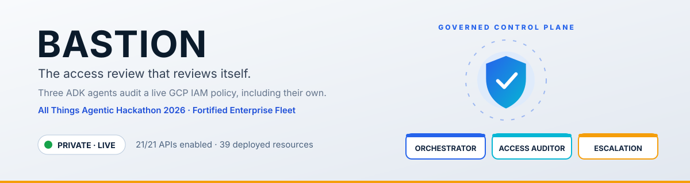

# Bastion

<p align="center">
  <picture>
    <source media="(prefers-color-scheme: dark)" srcset="assets/brand/banner-dark.svg">
    <source media="(prefers-color-scheme: light)" srcset="assets/brand/banner-light.svg">
    
  </picture>
</p>

<p align="center">
  <strong>Three institutional agents. One durable investigation identity. No raw IAM binding crosses the model or human-notification boundary.</strong>
</p>

<p align="center">All Things Agentic Hackathon 2026 · Fortified Enterprise Fleet</p>

<!-- Row 1 — repository state. Same five as the sibling repositories, same order.
     Publishing the demo: wrap the last line as
     [](https://youtu.be/YOUR_ID)
     Four minutes is the brief's ceiling — see submission/SUBMISSION.md.
     Nothing may be inserted between these badge lines: a comment breaks the paragraph and
     drops the badge after it onto a row of its own. -->
[](https://github.com/iarjunganesh/bastion/actions/workflows/ci.yml)
[](https://codecov.io/gh/iarjunganesh/bastion)
[](https://github.com/iarjunganesh/bastion/releases/latest)
[](LICENSE)


<!-- Row 2 — what Bastion is actually built on, plus the program badge earned before it. -->
[](https://google.github.io/adk-docs/)
[](https://github.com/a2aproject/a2a-python)
[](https://developers.google.com/profile/badges/community/gear?u=iarjunganesh)

<!-- Row 3 — the seven GEAP pillars, six of them managed products rather than modules here. -->
[](https://docs.cloud.google.com/gemini-enterprise-agent-platform/scale)
[](https://docs.cloud.google.com/gemini-enterprise-agent-platform/scale/runtime/agent-identity)
[](https://docs.cloud.google.com/gemini-enterprise-agent-platform/govern/gateways/agent-gateway-overview)
[](https://docs.cloud.google.com/gemini-enterprise-agent-platform/govern/agent-registry)
[](https://docs.cloud.google.com/gemini-enterprise-agent-platform/scale/memory-bank)
[](https://docs.cloud.google.com/model-armor/model-armor-vertex-integration)
[](https://docs.cloud.google.com/gemini-enterprise-agent-platform/optimize/observability/overview)

<!-- Row 4 — the rest of the deployed surface. -->
[](https://cloud.google.com/run)
[](https://cloud.google.com/eventarc)
[](https://cloud.google.com/firestore)
[](https://cloud.google.com/asset-inventory/docs)
[](https://cloud.google.com/vertex-ai)

<!-- Row 5 — language and toolchain. check_badge_versions() asserts these against the pins. -->
[](https://www.python.org/)
[](https://docs.astral.sh/ruff/)
[](https://mypy-lang.org/)
[](https://docs.pytest.org/)
[](https://vercel.com)

<!-- Row 6 — the public evidence console's own live hosting. The operational fleet stays on GCP;
     this is the presentation plane only, per the "public evidence console" note below. -->
[](https://bastion.arjunganesh.dev)

---

## The problem

Access review is quarterly work performed on continuously changing permissions. Automating the
scan is the easy part. An institutional agent has to do four harder things: remember decisions a
human made weeks ago, survive asynchronous retries without duplicating a page to a team, prove
why it acted long after it acted, and remain structurally unable to turn a suspicious permission
into a privileged write.

Most "AI for security" demos fail the fourth one quietly, because they hand the model the
production data and hope the prompt holds.

## What Bastion does

Bastion performs read-only IAM review against the live GCP project that runs it — including its
own service identities. Deterministic code detects, scores, and routes every finding. Gemini
writes the sentence explaining an already-minimized risk and decides no part of it. Humans
receive counts and allowlisted categories, never bindings.

**The load-bearing claim is not residency, it is minimisation.** Raw members, roles, resources
and bindings stop inside the deterministic Auditor tool and are discarded there. What crosses the
model boundary is an opaque HMAC identifier, a risk category, an owning department, and a bounded
score. There is no prompt from which a principal could be recovered, because no principal was
ever in one.

<p align="center">
  <picture>
    <source media="(prefers-color-scheme: dark)" srcset="assets/architecture/governed-investigation-flow-dark.svg">
    <source media="(prefers-color-scheme: light)" srcset="assets/architecture/governed-investigation-flow-light.svg">
    
  </picture>
</p>

There is no production in-process fallback. The Cloud Run Orchestrator is only the durable
Eventarc admission and dispatch boundary; it invokes the identity-bearing managed Runtime and
**never invokes a worker**. The Runtime discovers two worker agents through reviewed Agent Cards
and its Gateway-bound Registry allowlist.

## Run one investigation in 60 seconds

There is deliberately **no public agent endpoint**. Every operational service is IAM-private, and
exposing an agent purely to produce a shareable URL would contradict the submission. A separate
dependency-free evidence console is live at
[`bastion.arjunganesh.dev`](https://bastion.arjunganesh.dev/) from the source under
[`site/`](site/README.md). It serves only sanitized committed artifacts and makes no request to the
private fleet. The fleet itself remains reproducible:

```powershell
git clone https://github.com/iarjunganesh/bastion.git
Set-Location bastion

py -3.12 -m venv .venv
.\.venv\Scripts\Activate.ps1
python -m pip install -r requirements-dev.txt

# The offline gate — no cloud credentials, no network, no project required.
pytest tests --cov --cov-report=term-missing --cov-fail-under=100
```

`py -3.12` resolves only a CPython registered with the Windows launcher, which the python.org
installer does and uv, pyenv-win, conda and the Microsoft Store do not. If `py -0p` does not list
3.12, call that interpreter by its own path instead — `& "C:\path\to\python3.12.exe" -m venv .venv`
— or on macOS and Linux use `python3.12 -m venv .venv`. Any CPython 3.12 works; the launcher is a
convenience, not a requirement. The gate above is verified from a fresh public clone in
[10-reproducibility.md](submission/planning/10-reproducibility.md).

That runs the unit, integration, security and load suites against the real agent graph with the
cloud seams faked at their boundaries. To point it at a live project instead:

```powershell
Copy-Item .env.example .env
gcloud auth application-default login
python -m dotenv run -- adk run --in_memory agents/orchestrator `
  "Run one read-only Bastion access-review investigation."
```

`GOOGLE_CLOUD_LOCATION=global` is the model location. It must not be replaced by
`GCP_REGION=europe-north2`; doing so sends Gemini to an unavailable regional endpoint and
produces a 404 that reads like a missing model — see
[ADR-004](docs/adr/004-flash-only-global-endpoint.md).

## What is live

The committed [GCP measurement](assets/architecture/gcp-state.json) is generated from the live
project by `scripts/capture_gcp_state.py` and contains counts only — never a principal, an email,
or a policy binding:

- 21/21 named Google Cloud APIs enabled and 39 deployed resources measured;
- four Cloud Run services in `europe-north2`;
- a managed Agent Runtime and a separate durable Memory Bank in `europe-west4`;
- one Agent-to-Anywhere Gateway, IAP authorization extension, and fail-closed auth policy;
- a governed Agent Registry catalog containing the Runtime, two A2A workers, and every approved
  Google API egress destination;
- Firestore durable state, Pub/Sub/Eventarc delivery, a five-attempt dead-letter route, and a
  review subscription;
- a regional Model Armor template and two Secret Manager secrets;
- a 365-day regional audit bucket, four log-based metrics, five enabled alert policies, and the
  **Bastion Fleet Operations** dashboard.

Observed production checks include:

- a managed Runtime session traversing the Gateway and returning two streamed events;
- Pub/Sub → Eventarc → Firestore completion with one durable attempt;
- an unauthenticated findings request denied with `403`;
- the real Escalation Agent identity creating one redacted review record, followed by the same
  idempotency key being accepted without creating a duplicate;
- an exception a human approved on one day suppressing a matching finding three days later,
  across deployments and restarts — the owning team received **no** notification, not an empty
  one ([evidence 10](assets/evidence/10-cross-week-suppression.md));
- a Vertex quota failure recorded as a payload-free `model.request=failed`, with the
  investigation left reclaimable rather than cleared.

The retained evidence is indexed in [assets/README.md](assets/README.md). The exact distinction
between deployed, observed, configured, and still-to-capture lives in
[submission/SUBMISSION.md](submission/SUBMISSION.md) — those words are used precisely and are not
interchangeable in this repository.

Running against a live fleet rather than a mock is also what surfaced the defects this
project is most proud of catching. The sharpest: **ADK session state does not cross an A2A
boundary, in either direction, and nothing warns you** — `output_key` writes into the session
of the agent that *declares* it, which is shared in-process and separate over A2A. Every local
run and every CI job exercises the working topology, so the failure is invisible to an offline
gate by construction, even at 100% configured core statement and branch coverage. Reported
upstream with a production reproducer in
[google/adk-python#6854](https://github.com/google/adk-python/issues/6854) (opened by Arjun
Ganesh) and fixed structurally in
[ADR-012](docs/adr/012-structured-findings-across-a2a.md); the full ledger is the
[observation backlog](submission/planning/09-capture-backlog.md). Two upstream PRs address it,
both open at the time of writing: community PR
[google/adk-python#6859](https://github.com/google/adk-python/pull/6859) (Sylvester Kaczmarek)
adds warnings for the outbound state-only-loss and rejected inbound remote-state-delta
directions, and complementary PR
[google/adk-python#6862](https://github.com/google/adk-python/pull/6862) (Arjun Ganesh) adds the
adjacent construction-time warning for the `LlmAgent(output_key) -> RemoteA2aAgent` case that
carries event content and isn't covered by the state-only warning.

## The fleet

| Agent | Institutional responsibility | Enforced capability |
|---|---|---|
| **Orchestrator** | Own investigation lifecycle, policy, routing, and escalation | Managed Agent Identity; Registry/Gateway egress; Firestore state |
| **Access Auditor** | Read the live policy and produce opaque, deterministic findings | Read-only IAM, Asset Inventory, and Recommender access |
| **Escalation Agent** | Deliver a validated count to the owning department | Findings API invocation; **no IAM or Asset read role** |

The Cloud Run services expose two security shapes deliberately:

- worker [A2A origins on Cloud Run](https://docs.cloud.google.com/run/docs/ai/a2a-agents) are
  network-reachable because the cross-region managed Gateway is not
  classified as Cloud Run internal traffic; every non-health request still requires a
  Secret-Manager-backed origin credential, while Agent Identity is admitted per destination by
  IAP at the Gateway;
- the findings endpoint is network-reachable but IAM-private. Only
  `escalation-agent-sa` has `roles/run.invoker`; anonymous traffic is rejected by Cloud Run.

## Deterministic safety boundary

Bastion does not ask a model to decide whether a permission is safe.

1. The Auditor reads production IAM under a read-only identity.
2. Deterministic rules produce an opaque finding ID, category, department, and bounded score.
3. Those findings cross the A2A boundary as a validated schema, not as prose a model retypes.
4. The threshold and the department catalog are applied by a step that holds no model at all, and
   a gate refuses to escalate anything that step did not score.
5. Missing or invalid risk is rejected; it can never become a quiet clear.
6. A current, human-approved exception may suppress the same opaque finding until expiry.
7. The Escalation Agent is itself a model-free worker: it delivers to every routed department and
   only those, and a second gate refuses to report the investigation complete unless that
   delivery was confirmed.
8. Model Armor screens input — including tool results, not only prompts — and fails closed when
   unavailable.
9. A deterministic post-model screen blocks principal, role, resource, and PII shapes.
10. The receiver accepts only an allowlisted department, categories, deterministic summary, and
    SHA-256 idempotency key.

`AuditPlugin` is registered at every supported Runner seam — never called from inside an agent,
so there is no audit call site to forget or bypass. It records run, agent, model, and tool
starts/completions/failures plus Model Armor refusals. Records contain event type, outcome,
actor, investigation ID, invocation ID, argument **names**, model name, and exception
**class** — never argument values, prompts, responses, principal IDs, or exception messages.

The two ids answer different questions. `invocation_id` groups one agent run; ADK mints a fresh
one per run, so it stops at the A2A boundary. `investigation_id` is the durable event id, carried
to each worker as request metadata rather than as message content, so no model reads or restates
it — it is what makes a single investigation reconstructable across all three hops. It is
re-validated as a UUID where it is recorded, because it arrives from a peer.

Tool surfaces are fixed and repository-owned; no external text is ever interpolated into a tool
declaration ([ADR-007](docs/adr/007-tool-poisoning.md)), and the Model Armor threshold is an
explicit decision rather than a default ([ADR-009](docs/adr/009-model-armor-threshold.md)).

## What "scalable network" means here

The track asks for a *scalable network of institutional agents*. Bastion's scaling axis is
deliberately **not** more agents — [ADR-002](docs/adr/002-three-agents.md) fixes the fleet at
three, because a fourth agent with the same data access proves nothing that a third does not.
The network scales on the axes that actually matter in an institution:

| Axis | How it grows | Cost of growth |
|---|---|---|
| **Owning departments** | A row in the catalog with its principal patterns; routing picks it up with no code change | One catalog entry |
| **Throughput** | Bounded Cloud Run autoscaling behind durable Eventarc delivery, with leases, retry, and a five-attempt dead letter | Configuration |
| **A new institutional agent** | A Registry Agent Card, an approved Gateway destination, an Agent Identity, **and** a deliberate change to `agents/orchestrator/agent.py`'s `SequentialAgent` to invoke it | Governance, not automatic discovery |

The third axis is deliberately the expensive one. Nothing in `build_sub_agents()` discovers or
invokes a newly registered agent on its own — a fourth agent requires the same review as the
three that exist today: Registry, Gateway policy, and identity, plus code review of exactly what
it can reach. That is the fixed trust boundary [ADR-007](docs/adr/007-tool-poisoning.md) depends
on working as intended, not a scalability gap.

The measured proof that the first axis is real rather than decorative is
[evidence 09](assets/evidence/09-cross-department-routing.md): 52 live IAM bindings produced 3
findings that routed to **2 different owning departments**, deterministically and without a
model deciding who owns what.

Instance caps are deliberate. `BASTION_MAX_INSTANCES=3` follows the organizers' own cost
guidance; it is a budget ceiling, not an architectural one. Bastion claims **two** Gateway
refusals rather than three, because two are what the managed control actually enforces — the
reasoning is recorded in [ADR-003](docs/adr/003-pillars-on-geap.md) rather than quietly dropped.

## How the track requirements are answered

| Track requirement | Bastion evidence |
|---|---|
| Agents cataloged for cross-department use | Versioned Agent Cards publish owner, department, purpose, skill, classification, policy version, approval state, and health metadata. `route_by_department()` turns ownership into an enforced routing decision. |
| Context maintained across weeks of asynchronous work | Stable event/context IDs, Firestore inbox and leases, managed sessions and Memory Bank, expiring human-approved exceptions, retry/dead-letter handling, and idempotent notification keys. Observed across a real three-day gap spanning deployments and restarts. |
| Production data without violating compliance, sovereignty, or security policy | Read-only Cloud Asset Inventory. **No raw member, role, resource, or binding ever crosses the model boundary** — only opaque IDs, categories, departments, and bounded scores — so sovereign data is not merely kept in-region, it never leaves the process. Model Armor fails closed, output is screened before notification, logs carry no payload values, identities are separated, and state stays in the EU. |

## Architecture

<p align="center">
  <picture>
    <source media="(prefers-color-scheme: dark)" srcset="assets/architecture/enterprise-fleet-overview-dark.svg">
    <source media="(prefers-color-scheme: light)" srcset="assets/architecture/enterprise-fleet-overview-light.svg">
    
  </picture>
</p>

<p align="center">
  <picture>
    <source media="(prefers-color-scheme: dark)" srcset="assets/architecture/enterprise-fleet-architecture-dark.svg">
    <source media="(prefers-color-scheme: light)" srcset="assets/architecture/enterprise-fleet-architecture-light.svg">
    
  </picture>
</p>

All three diagrams are generated from one reviewed master each by `scripts/render_diagrams.py`,
which emits the light and dark variants and an animated GIF. The masters are gated: every
resource count in every diagram must equal the live capture, retired deployment claims are
blocked, and no animated packet may cross a component it is not entering or leaving. A diagram
that disagrees with the fleet fails CI. See [docs/ARCHITECTURE.md](docs/ARCHITECTURE.md) for
trust-boundary detail and [ADR-006](docs/adr/006-pillar-coverage.md) for what counts as observed.

## Durability and failure tolerance

The Eventarc boundary atomically admits an event before work starts. A running event owns a
bounded lease; concurrent duplicates receive `503` so Eventarc retains delivery. A dead worker's
expired lease can be reclaimed. Completed events are acknowledged without rerunning. Failed
events remain retryable. Delivery is capped at five attempts before the separate dead-letter
review subscription receives it.

Human escalation is independently idempotent. The tool derives
`sha256(investigation_id:department)` and the private receiver creates the document exactly once.
The same authorized request returns success with `accepted=false` on replay.

Operational objectives and alert mappings are in [docs/OPERATIONS.md](docs/OPERATIONS.md).

## Data sovereignty

**Sovereign data never reaches the model at all.** Residency keeps regulated data inside a
region; Bastion does something stronger with the part that matters. That is why the deterministic
pre-pass exists: `find_anomalies()` decides what is a finding, and Gemini only writes the
sentence explaining one. A compliance product cannot answer *"why was this flagged?"* with *"the
model thought so"*, and it cannot leak a binding it was never given —
[ADR-001](docs/adr/001-real-iam-not-mock-data.md) and
[ADR-005](docs/adr/005-adk-as-the-agent-framework.md) record why real data and this framework,
and what each cost.

Where the infrastructure runs:

- Cloud Run, Firestore, Pub/Sub, and Eventarc run in `europe-north2`.
- Agent Runtime, Memory Bank, Gateway, Registry, Model Armor, and the retained audit bucket run
  in `europe-west4`.
- Gemini 3.5 Flash uses Vertex AI `global`. **Global is not a regional-residency claim**, and
  Bastion does not make one. The minimisation above is the control; the region is not asked to be.

The field-level inventory, retention, deletion, and processor boundaries are in
[docs/DATA_GOVERNANCE.md](docs/DATA_GOVERNANCE.md).

## Deploy

Requirements: Python 3.12, Google Cloud CLI, Application Default Credentials, and a project with
the documented APIs and a Model Armor template.

The idempotent bootstrap accepts explicit regions and existing Memory/Runtime IDs, creates
missing generated secrets without printing them, provisions identities and durable resources,
builds one image, deploys the fleet, configures Gateway/Registry/Runtime, provisions
observability, verifies the inventory, and runs the production smoke test.

```powershell
.\infrastructure\bootstrap.ps1 `
  -Project 'YOUR_PROJECT_ID' `
  -MemoryAgentEngineId 'YOUR_MEMORY_ENGINE_ID' `
  -RuntimeAgentEngineId 'YOUR_RUNTIME_ENGINE_ID'
```

The prerequisite and least-privilege role list is in
[infrastructure/REQUIRED_GCP_ACCESS.md](infrastructure/REQUIRED_GCP_ACCESS.md).

Useful independent gates:

```powershell
$env:GCP_PROJECT_ID = 'YOUR_PROJECT_ID'
$env:GCP_REGION = 'europe-north2'
$env:AGENT_RUNTIME_REGION = 'europe-west4'
$env:BASTION_RUNTIME_AGENT_ENGINE_ID = 'YOUR_RUNTIME_ENGINE_ID'

python -m infrastructure.verify_fleet
python -m infrastructure.provision_observability
python -m infrastructure.smoke_test
python -m infrastructure.rollback       # dry-run candidates only
python -m infrastructure.teardown       # dry-run plan only
```

Applying rollback requires an exact service and one of its two newest safe revisions. Applying
teardown additionally requires `--confirm-project`; by design it preserves Firestore, secrets,
Agent Runtime, and retained compliance logs.

## Quality gates

```powershell
ruff check .
ruff format --check .
mypy agents gateway identity registry runtime model_armor observability infrastructure
pytest tests --cov --cov-report=term-missing --cov-fail-under=100
python scripts/check_docs.py
python scripts/check_versions.py
python scripts/render_diagrams.py --check
node site/build.mjs
python scripts/check_site.py
```

`check_docs.py` is not a linter. It fails the build when a document disagrees with the
repository: a wrong pillar or agent count, an ADR that exists but is unindexed, a badge quoting a
version that is not pinned, a hand-written status badge that would go stale, a retired deployment
claim, a diagram whose numbers no longer match the live capture, or an animated packet drawn
through a component. Every one of those rules exists because that exact mistake was made here
once.

CI holds no GCP **key**, and never will: `infrastructure/provision_wif.sh` federates GitHub
Actions through Workload Identity, so a short-lived OIDC token is exchanged for a short-lived
Google one. There is nothing to leak and nothing to rotate. The provider pins
`assertion.repository` to one repository — Google accepts any token GitHub's issuer signs, and
GitHub signs one for every repository on the platform, so that condition is the entire boundary.

The federated identity may deploy **code** and may not change **authority**: `run.developer`
rather than `run.admin`, and no role that can create a binding or alter Eventarc, Pub/Sub, the
Agent Registry, Firestore, Secret Manager, or the audit bucket. It may act as the three workload
identities and not as the approver identity, so a pipeline cannot approve the suppression of a
finding. The Deploy workflow is `workflow_dispatch` only, because deploying a live
access-governance fleet is a decision someone should make rather than a consequence of merging.

**Configured 2026-08-22, not yet exercised.** The pool, provider and grants exist, and the
boundary is verified twice over: the provider admits only `assertion.repository ==` this
repository, and impersonation is bound to that same repository's `principalSet` rather than
to the pool, so an error in either is caught by the other. The deployer holds the five roles
above and cannot act as the approver identity. No deploy has run through this path yet, so
nothing here is claimed as observed.

## Repository map

```text
agents/                     three ADK agent definitions and managed Runtime entrypoint
gateway/                    local policy contract and Cloud Run origin authentication
identity/                   least-privilege workload manifest
model_armor/                fail-closed input and deterministic output screening
observability/              payload-free ADK audit plugin
registry/                   department routing policy
runtime/                    durable SQLite contract and Firestore production adapter
infrastructure/             bootstrap, deploy, Gateway, Runtime, smoke, rollback, teardown
scripts/                    live-state capture, docs/version gates, diagram renderer
site/                       static public evidence console; no operational backend or GCP calls
tests/                      unit, integration, security, and load suites
assets/                     brand, architecture, and redacted evidence
docs/                       architecture, governance, operations, and ADRs
submission/                 Devpost copy, checklist, and planning ledger
```

## Evidence and decisions

- [Architecture](docs/ARCHITECTURE.md) · [Data governance](docs/DATA_GOVERNANCE.md) ·
  [Operations](docs/OPERATIONS.md) · [Security](SECURITY.md)
- [Evidence index](assets/README.md) · [Submission readiness](submission/SUBMISSION.md) ·
  [Observation backlog](submission/planning/09-capture-backlog.md) ·
  [Audit remediation ledger](submission/planning/08-audit-remediation-plan.md) ·
  [Captured hackathon brief](submission/DEVPOST.md)
- Architecture decisions — [index](docs/adr/README.md):
  [001 real IAM](docs/adr/001-real-iam-not-mock-data.md) ·
  [002 three agents](docs/adr/002-three-agents.md) ·
  [003 managed platform](docs/adr/003-pillars-on-geap.md) ·
  [004 global Gemini](docs/adr/004-flash-only-global-endpoint.md) ·
  [005 ADK and A2A](docs/adr/005-adk-as-the-agent-framework.md) ·
  [006 observable pillar proof](docs/adr/006-pillar-coverage.md) ·
  [007 tool poisoning](docs/adr/007-tool-poisoning.md) ·
  [008 human approval loop](docs/adr/008-human-approval-loop.md) ·
  [009 Model Armor threshold](docs/adr/009-model-armor-threshold.md) ·
  [010 policy enforcement gate](docs/adr/010-policy-enforcement-gate.md) ·
  [011 inbound screening covers tool results](docs/adr/011-inbound-screening-covers-tool-results.md) ·
  [012 structured findings across A2A](docs/adr/012-structured-findings-across-a2a.md)

## Trust statement

Bastion is read-only with respect to IAM. It can identify, explain, suppress under a current
human exception, and request review; it cannot modify or revoke a binding. Raw production policy
dumps, credentials, endpoint secrets, and unredacted findings are prohibited from Git and
published evidence.

It does not claim immutable audit storage, end-to-end EU model residency, legal certification,
historical SLO attainment, or that a wall-clock week elapsed during testing. Those limits are
part of the topology rather than disclaimers appended to it.

This is a hackathon submission, not supported production software. Licensed under the
[MIT License](LICENSE).
