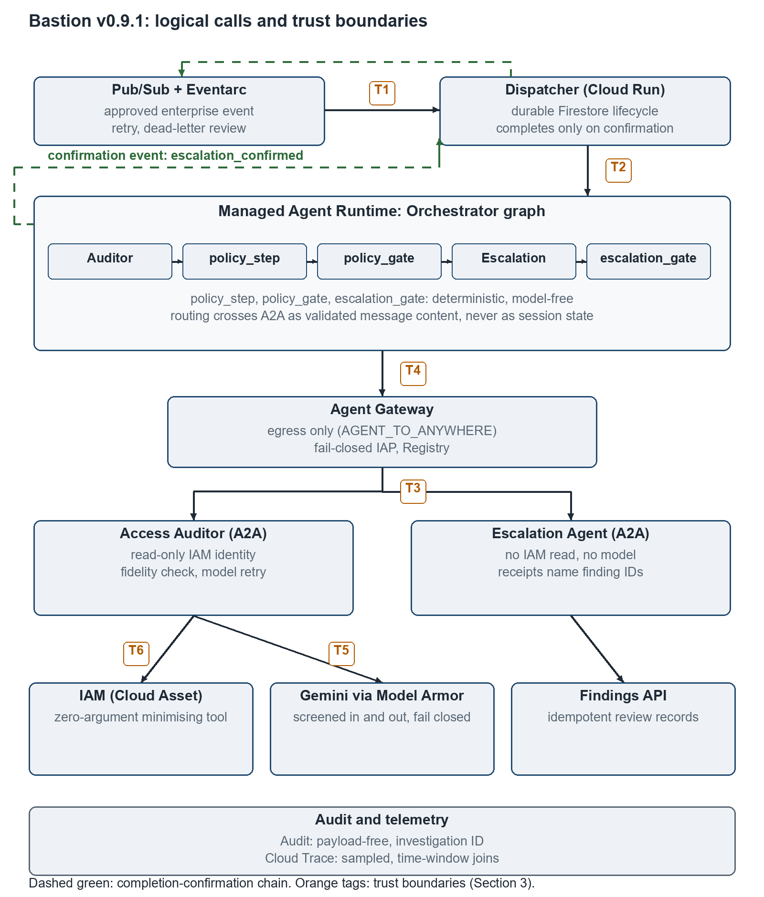

## 4. Design as finally deployed (v0.9.1)

This section describes the source deployed on 7 November 2026 (tag `v0.9.1`, `755dd07`) and evaluated in Section 7. Earlier forms of the design appear only where Section 6 needs them. [S1, S14, E26]

### 4.1 Topology

Bastion has three institutional agents. Each is defined by its workload identity and its responsibility:

- the **Orchestrator** owns the investigation;
- the **Access Auditor** reads policy under a read-only identity;
- the **Escalation Agent** delivers reviews, cannot read IAM, and uses no language model.

An approved enterprise event enters through Pub/Sub and Eventarc and reaches a private Cloud Run dispatcher. The dispatcher admits the event into a Firestore investigation lifecycle and invokes the managed Agent Runtime. It has no local fallback and cannot call the workers directly. The Runtime runs the Orchestrator graph:

```text
Access Auditor → policy_step → policy_gate → Escalation Agent → escalation_gate
```

`policy_step`, `policy_gate` and `escalation_gate` are deterministic steps inside the Orchestrator (ADK `BaseAgent`s), not further agents. The Auditor and the Escalation Agent run as protected A2A services on Cloud Run. Runtime egress passes through the managed Agent Gateway (T4). There is no Scheduler job: the fleet is event-driven. [S1, S7, E05, E15]



*Figure 1. Logical call relationships and trust boundaries of v0.9.1. Runtime-to-worker arrows denote A2A calls whose egress traverses the Agent Gateway (T4) before reaching the workers (T3). Dashed green arrows show the completion-confirmation chain. Audit records join by investigation ID; traces are matched by time window. Regions: transport and Firestore in `europe-north2`; managed agent services and audit in `europe-west4`; Gemini inference on Vertex AI `global`.*

### 4.2 Minimisation at the policy-reading boundary

The Auditor's `audit_iam_policy` tool takes no arguments. It reads its project from deployment configuration, so caller text cannot redirect it. It reads IAM through Cloud Asset Inventory (at most 500 policy results), flags `roles/owner` and `roles/editor` grants and assigns a fixed score of 0.8. Binding conditions are not retained, and stale identities are not detected. [S2]

Each finding carries four deterministic fields:

- an opaque ID: the first 24 hex characters of HMAC-SHA256 (a keyed hash-based message authentication code) over the member-role pair, under a secret key;
- the owning department;
- a reason code;
- a score in [0, 1].

Members, roles, resources and bindings are not fields of this representation. The keyed ID lets a later step match a human exception without the principal ever reaching the model. It is pseudonymous, not anonymous: findings remain linkable by ID, and the department and category are disclosed. [S2, S3]

### 4.3 Schema validity and fidelity are separate controls

The model writes a rationale of at most 280 characters per finding and returns an `AuditReport`. The schema bounds the shape of each field, but a plausible replacement ID or a changed score would still satisfy it. The Auditor therefore records the canonical tool result with an `after_tool_callback`, and an `after_model_callback` compares the final report against it:

- the ID set must match, and duplicates are refused;
- department, category and score must match for each finding;
- the count must equal the list length;
- since v0.9.0, fields outside the schema are refused.

A mismatch raises `AuditorFidelityError` inside the Auditor, before anything reaches the Orchestrator. [S2, S6]

### 4.4 Deterministic policy authority and explicit handoffs

The validated report crosses A2A as structured message content. The Orchestrator fails closed when that content is absent or malformed; a valid empty list is a legitimate outcome. `policy_step` calls the policy functions directly, without a model. It applies the threshold, consults current human exceptions by opaque ID and routes the surviving findings by department, naming each finding ID. It emits its routing as message content, because session state does not cross A2A (Section 6.1). `policy_gate` then requires evidence written by the deterministic enforcement code itself. A non-empty reply is not evidence that policy ran, and a missing result raises `PolicyNotEnforcedError`. [S6, S7]

Since v0.9.0, routing that arrives attributed in the relayed history is accepted only from `policy_step`; routing attributed to the Auditor is rejected as `missing_routing_envelope`. A bare, unattributed JSON envelope on the authorised request path is still accepted by design, bounded by the worker-origin credential. [S8, E27]

### 4.5 Delivery, receipts and completion

The model-free Escalation Agent validates the envelope's shape, department-catalog membership, opaque-ID form and counts. It then calls a fixed delivery function once per department; the destination is owned by the deployment, not the message. Delivery uses a SHA-256 idempotency key over the investigation and department, so the findings API creates each review record once. Since v0.9.0, each receipt names exactly the finding IDs delivered to its department. [S6, S8]

Completion is a chain of confirmations:

1. `escalation_gate` (`EscalationCompletionGate`) compares the receipts with the routing that `policy_step` produced. If every routed department is confirmed with exactly its finding IDs, it emits a state change authored `escalation_gate` with `escalation_confirmed: true`. Otherwise it raises.

2. The dispatcher (`run_managed_runtime`) marks the investigation completed only when that confirmation appears in the Runtime's response stream. A stream that ends without it raises `RuntimeIncompleteError`. The durable record is then marked failed and Eventarc redelivers.

The expected event shape is pinned by a test against the Agent Runtime SDK's own serializer. If that shape ever changes, investigations fail closed and visibly rather than completing falsely. [S7, S12]

### 4.6 Screening, identities and approvals

Model Armor screening fails closed around every model call (T5). Inbound screening covers tool-result content, and deterministic protected-data screening follows model output. Human exceptions are approved through an IAM-private findings API that accepts only the configured approver identity. Each service has its own workload identity, and only the Auditor's can read IAM. [S4, S9, E03, E17]

### 4.7 Bounded model retry (v0.9.1)

The Auditor's model client (`RetryingGemini`) retries a provider error only when all of these hold:

- the status is 429, 500, 502, 503 or 504;
- no response has yet been yielded;
- fewer than four provider attempts have been made for this logical call.

Each wait has a ceiling that starts at 2 s and doubles after every failed attempt, up to 10 s; the actual wait is 50–100% of that ceiling (jitter). Each retry writes a payload-free `model.request/retrying` audit record, and the request is restored to its original state before every attempt. Any other error, or an exhausted retry, propagates, so the investigation still fails closed. [S15]

### 4.8 Durable ingress, audit and telemetry

Firestore records admission, leases, attempts and terminal state. A replayed event whose investigation already completed is acknowledged without repeating work. Failed dependencies and expired leases can be reclaimed. The Eventarc push subscription has a 600 s acknowledgement deadline, exponential retry from 10 s to 600 s, and a dead-letter policy targeting about five delivery attempts; Google documents that count as approximate. [S1, E06, R11]

Audit records carry event metadata and correlation IDs. They never carry prompts, responses, tool values, principals or exception text. An invocation ID identifies one agent run. An investigation ID, seeded by the dispatcher as run metadata and forwarded to the workers as A2A request metadata, joins the distributed flow. The audit bucket keeps 365 days in `europe-west4` and is not locked. Cloud Trace is separate, sampled telemetry. Since v0.9.0, the Runtime restores the setting that keeps message content out of spans after the managed template's set-up. Inference on Vertex AI `global` rules out any claim of end-to-end EU residency. [S3, E07, E28]
