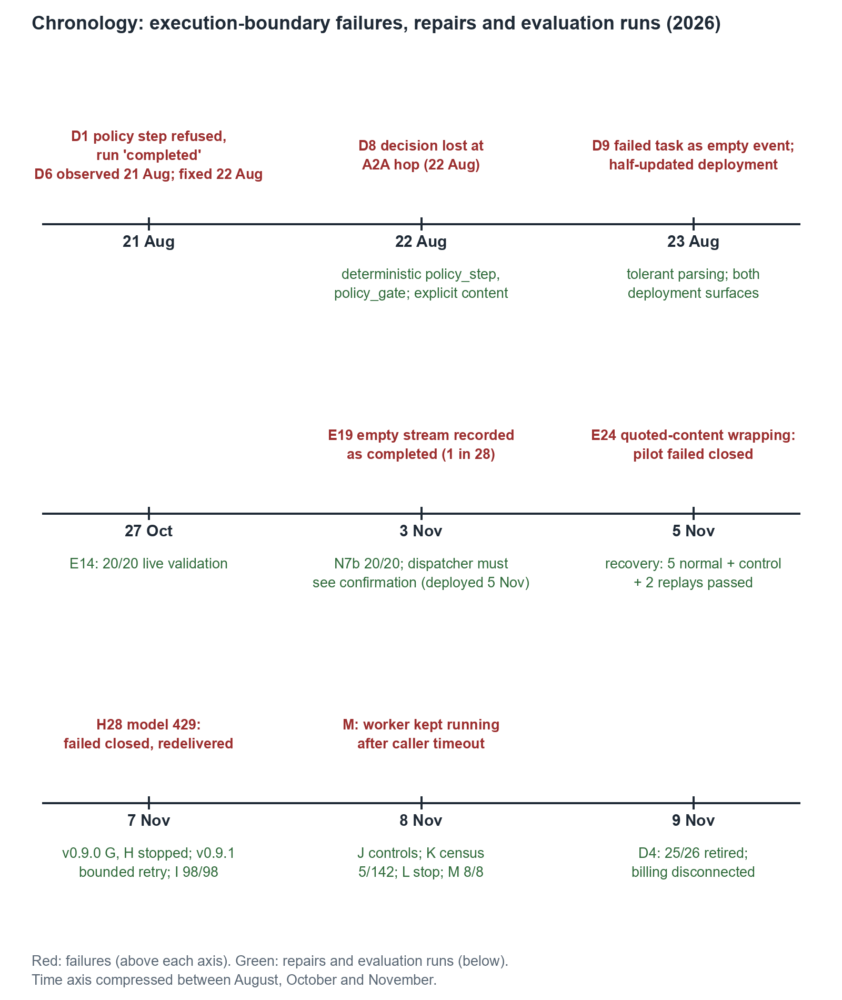

## 6. Execution-boundary failures and control evolution

Where established, each failure below records when it was observed, what was observed, the repair, its deployment and verification, and what remains unresolved. The entries distinguish application contract violations from framework-documented semantics where the evidence establishes that attribution. An *application contract violation* means Bastion's own code broke its stated invariant. *Framework-documented semantics* means the framework behaved as documented and Bastion's assumption was wrong. Figure 2 places the failures alongside the evaluation runs.

*Figure 2. Selected failures, repairs and evaluation runs, August–November 2026. Failures are above the line; repairs and evaluation runs are below it. The complete stop ledger is in Appendix C.1. N7 and N7b are E19's stopped and fresh batches (Appendix C.1). The August deployment served until 5 November; v0.9.0 and v0.9.1 were deployed on 7 November, and I continued into 8 November.*

### 6.1 Historical failures

**D1: policy enforcement disappeared, and the run reported success (21 August, observed).** At the time, `policy_step` was an `LlmAgent` whose policy tools could be reached only through a model call. Its `before_model_callback` refused, so the model never ran and neither tool executed. In two runs (16:27:49Z and 16:34:49Z), the investigation still continued to escalation: the human notification was delivered twice and `investigation.run` reported `completed`, with no error recorded. Enforcement did not fail closed; it vanished.

- *Repair:* `policy_step` became a model-free `BaseAgent` that calls both functions directly, and `policy_gate` was added. The gate refuses to continue unless the deterministic path left its own result. [S7]
- *Deployed and verified:* release 0.2.0; observed fixed on 22 August.
- *Classification:* application contract violation.

**D6: the Auditor's report never left its own session (21 August, observed).** ADK writes an agent's `output_key` into the session of the agent that declares it. The Auditor's findings therefore landed in the worker's session and never returned to the Orchestrator. The deployed Orchestrator found no report and refused. Every local run and test saw a populated key, because in-process the two agents share one session.

- *Repair:* `policy_step` reads the Auditor's validated A2A reply.
- *Deployed and verified:* 22 August.
- *Classification:* framework-documented semantics. Bastion's assumption was the violation. [S6]

**D8: a policy decision did not survive the escalation hop (22 August).** A human-approved exception was correctly scored `suppress` and excluded from routing, then escalated anyway. Two causes combined. `policy_step` emitted its result only as a `state_delta`, and ADK builds the outgoing A2A message from content, so the most recent content the Escalation Agent saw was still the Auditor's report. And the routing output named no finding IDs.

- *Repair:* explicit routing content carrying finding IDs.
- *Verified:* E10.
- *Upstream:* reported as google/adk-python#6854. The maintainers confirmed per-agent sessions as intended. A community PR (6859, by Sylvester Kaczmarek) carried two of the author's commits, a legacy-path warning and an end-to-end test. Upstream imported that change as commit `d2cb22e`, which added warnings for both directions, first released in `google-adk` 2.12.0. [U1–U4]
- *Unresolved:* the terminal status of the affected runs is not independently established.

**D9: a fourth instance, introduced and fixed the same day (23 August).** While deploying the model-free Escalation Agent, every investigation failed at the worker with a correctly audited refusal (`missing_routing_envelope`), and every one still reported `completed`. Three mechanisms compounded:

- the callee read the wrong channel;
- ADK's attribution-wrapped history (`[policy_step] said: {...}`) defeated a bare JSON parse;
- `RemoteA2aAgent` turned the failed remote task into a contentless, error-free event.

A half-updated deployment then left the completion gate out of the live graph. The Cloud Run script had updated the workers, but the Orchestrator graph runs on the managed Runtime, which has its own deployment path.

- *Repair:* tolerant parsing, and both deployment surfaces updated.
- *Verified:* the gate was observed passing, with exactly one review record created and the approved exception still suppressed. [S6, E10]

**E19: a falsely completed investigation (3 November, cohort N).** Run 8 of the repeatability batch was recorded as completed after one attempt and 81 s, with no audit record, review or model call. The request reached the managed Runtime, and two new Runtime instances started during the run. The dispatcher treated the end of the Runtime's response stream as success. An empty stream therefore became a completed investigation, and because nothing failed, Pub/Sub had no reason to redeliver. Only the batch's external stop rule noticed. Across that batch and its fresh repeat, 1 of 28 investigations was a false completion. [E19]

- *Identified dispatcher bug:* the end of the stream was treated as success.
- *Repair and deployment:* the dispatcher requires the completion gate's confirmation; deployed with the 5 November upgrade and verified as described in Section 6.2.
- *Unresolved:* the underlying Runtime cause is not established. Instance replacement is not claimed as the cause.

**Two smaller instances after the upgrade.** Neither produced a false success.

- *E24, 5 November.* The upgraded SDK wrapped relayed routing JSON in quoted-content markers, which the Escalation parser rejected. The pilot failed closed across five automatic deliveries. The offline re-run of the A2A boundary the day before (E22) had recorded the new wrapping, but the parser had not been re-tested against it. [E22, E24]
- *H28, 7 November.* A model-service 429 failed the run closed (`PolicyNotEnforcedError`). Pub/Sub then redelivered it, and the second attempt completed. [E26]

### 6.2 Corrective controls and verified recovery

Attribution is kept distinct below. A control is credited only with what an observation shows it did.

| Control | Answers | What the evidence shows |
|---|---|---|
| Deterministic policy authority and explicit A2A handoffs (ADR-010, ADR-012) | D1, D6, D8, D9 | Fixed August path verified by E10 and E11. The O1 re-run on `google-adk` 2.13.0 (E22) shows state still does not cross A2A in either direction, and the upstream warnings now fire. Correctness rests on the explicit content contracts |
| Dispatcher completion confirmation (`run_managed_runtime`) | E19 | Positive confirmations observed directly in the recovery's direct Runtime control (E25) and in J0, K1 and K2 (E27, E28). Completed normal investigations on v0.9.x imply that the dispatcher saw the confirmation, under its implemented contract. The F pilot (E24) and M (E29) each show the dispatcher rejecting a missing confirmation 5 times (`RuntimeIncompleteError`) |
| Policy gate failing closed | D1 | H28 shows a failed-closed policy-execution path after a model 429 (`PolicyNotEnforcedError`, E26) |
| Quoted-routing parser correction | E24 | The pilot failed closed on 5 November (E24). The separate corrected recovery passed five normal cases (median client confirmation 20.375 s), one direct control and two replays (E25) |
| Routing provenance and finding-ID receipts (v0.9.0) | Review finding, no observed harm | Auditor-attributed routing is rejected (`missing_routing_envelope`, 0 reviews); the policy-step positive control completed (E27) |
| Span-content setting restored after template set-up (v0.9.0) | Configuration finding | 0 content-bearing attributes in 142 inspected traces (E28) |
| Bounded, audited model retry (v0.9.1) | H28 | I57: one 429, recovered within one durable attempt (E26) |

None of the F pilot, H28 or M is evidence that `EscalationCompletionGate` itself executed and rejected an invalid receipt. In the F pilot, the Escalation Agent rejected the routing envelope and no receipt was produced. In H28 the failure occurred at the policy step. In M, Escalation never ran. The gate's rejection path is covered by unit tests, not by a live observation.

Routing provenance was a source fix made on 7 November after an independent review: the earlier worker took the first relayed part carrying `departments`. No live harm was observed. The fix shows that Auditor-attributed routing in the relayed history is rejected. It does not show that unauthorised routing can never be accepted. A bare JSON envelope on the authorised request path is still accepted by design, bounded by the worker-origin credential.

I57 shows one successful model-level retry, not general recovery from service failure.

### 6.3 Remaining boundary limitations

- **Gateway misclassification (D2, E20).** The Runtime SDK's start-up project lookup to a registered Resource Manager host is refused as `unregisteredEndpoint`. The inferred mechanism is that IAP does not match registered destinations with non-standard Google hostnames (`*.rep.googleapis.com`, `*.mtls.googleapis.com`) to their Registry entries. Plain `*.googleapis.com` egress is not IAP-checked at all. Between 5 October and 4 November, IAP made 176 such denial decisions (88 failed lookups). Investigations completed throughout. The cause is platform-side and inferred, not confirmed by Google. [E20, S5]
- **Incomplete Runtime graph-span export (E28).** In the census defined in Section 7.4, 5 of 142 agent traces carry Runtime graph spans: those matching F1 from the 5 November recovery, H1, J0, K1 and L1 by time window. K1 had them and K2, run immediately after, did not. Each of the five followed a pause; the converse was not tested. The root cause is unresolved, and no platform rule is claimed.
- **No cancellation guarantee (E29).** In M's tested configuration, worker execution continued beyond the five estimated caller timeout boundaries; cancellation propagation is not guaranteed (Section 7.5).
- **Teardown coverage (D4, 9 November).** The allowlisted teardown deleted 25 of its 26 serving targets. It stopped at the Gateway (`FAILED_PRECONDITION`); read-only checks then found that a retained Runtime engine still references it and that an authorisation policy targets it. The cause of the refusal is not established. The script's dry runs did not predict the refusal; they do not inventory the Gateway's dependants (Appendix A.4).
