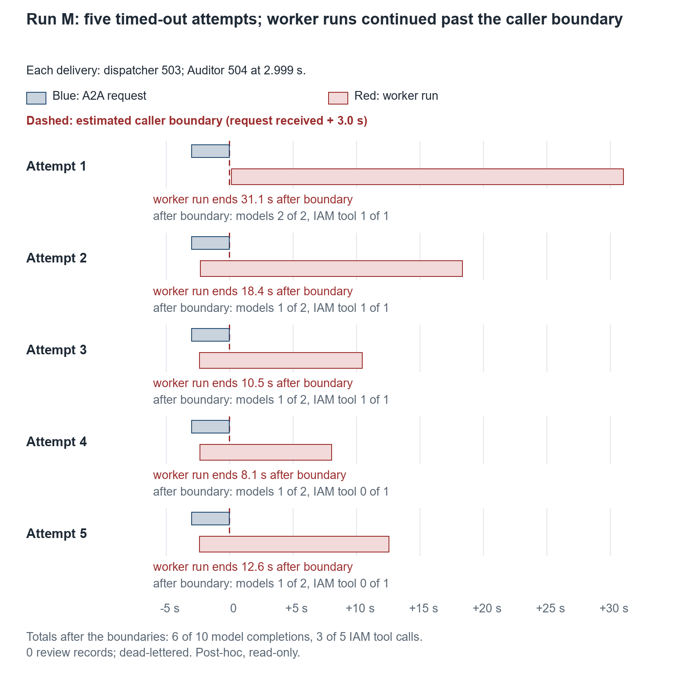

## 7. Final bounded evaluation

### 7.1 Run ledger G–M

The runs follow different protocols. The ledger is a record of what happened, never a rate.

| Run | Fleet | Classification | Evidence |
|---|---|---|---|
| G | v0.9.0 | Instrument stop after 4 validated passes. The first Firestore read after a two-minute idle exhausted its 20 s retry deadline. A read-only drain found that G5 had completed in the cloud in one attempt with 28 audit records | E26 |
| H | v0.9.0 | System failure at H28. A model 429 failed the run closed; it was redelivered, and attempt 2 completed. Stopped by rule after 27 validated passes | E26 |
| I | v0.9.1 | 98 validated passes, then an instrument stop at I99 when Cloud Logging returned HTTP 500 beyond the read window. A separate read-only addendum shows I99 met every criterion; it stays outside the 98 | E26 |
| J | v0.9.1 | Direct control, five replays, a refusal probe and the envelope pair: all passed | E27 |
| K | v0.9.1 | Trace-export isolation (two direct investigations), plus the read-only census | E28 |
| L | v0.9.1 | Instrument failure in its first read (an invalid field mask). The fault never reached its investigation, so no valid injection occurred. Configuration restored and verified | E29 |
| M | v0.9.1 | Attempt 1 stopped in preflight, before any injection or publication. Amendment M-A1 was recorded at 09:26:18Z. Attempt 2 met all 8 pre-specified criteria | E29 |

M's preflight attempts are protocol execution attempts. They are never called durable attempts; that term means the five deliveries of M's investigation.

### 7.2 Cohort I

Cohort I ran serially from 22:53Z on 7 November to 01:52Z on 8 November on the v0.9.1 deployment.

| Measure | G (v0.9.0) | H (v0.9.0) | I (v0.9.1) |
|---|---|---|---|
| Validated investigations / publications | 4 / 5 | 27 / 28 | 98 / 99 |
| Client confirmation, median (range), s | 18.258 (15.485–31.172) | 15.484 (15.250–86.094) | 15.453 (15.250–60.781) |
| Correlated audit records, validated runs | 112 | 756 | 2,745 |
| Review records / model completions | 8 / 8 | 54 / 54 | 196 / 196 |
| Audited model retries | — | — | 1 (I57) |

Confirmation times are measured from publication to the client's first poll that observes completion, so they include 5 s polling. Over each isolated window, project-wide token counts were 167,064 input and 163,604 output for I; these are project totals, not per-request attribution. During I, observation reads retried 3 times on HTTP and 22 times on Logging, within their bounded windows. G and H are separate stopped cohorts and are not pooled with I. [E26]

**I57.** The Auditor's model call received a 429, `RetryingGemini` retried once and the call recovered within the same durable attempt. This is one successful model-level retry, not a demonstration of general recovery.

### 7.3 J controls

J deployed nothing. Its preflight confirmed that the fleet was exactly I's deployment, with the same baseline.

| Case | Observation |
|---|---|
| J0, direct Runtime control | Completion confirmation observed in the returned stream (5 events, 94.2 s, the first run after an idle period); 28 audit records, 2 model completions, 2 review records equal to baseline, no retries |
| Five completed-event replays (E27's R1–R5) of I1, I25, I50, I75 and I98 | One HTTP 200 delivery each. Within each 120 s window, no additional durable, review, agent-invocation or model effects compared with the originals' recorded state |
| X1, direct Auditor refusal | Exactly one Model Armor input refusal, joined to the probe's own investigation ID; task state failed; no model or tool work at or after the refusal over 75.8 s; no review record |
| Envelope positive control | Policy-step routing with zero departments: task completed, no rejection, 0 reviews |
| Forged envelope | Model-written departments attributed to the Auditor: rejected as `missing_routing_envelope`, task failed, 0 reviews |

I's plan named a replay of I100, which never ran. J's protocol substituted I98, I's last validated run. The substitution was recorded at 08:29:01Z, before execution began at 08:29:29Z. The replays are five bounded duplicate-delivery observations, not a guarantee of exactly-once delivery. J0 shows a positive confirmation; it does not test the completion gate's rejection path. [E27]

### 7.4 Telemetry

J0 produced one connected trace of 172 spans. It contained the Runtime graph (`invoke_workflow orchestrator`, `policy_step`, `policy_gate`, `escalation_gate`), both worker workflows, two model calls and one tool call, with no content-bearing attributes. K then ran two direct investigations back to back. K1 (47.5 s) exported Runtime graph spans; K2 (13.9 s), immediately after, did not. Worker, model and tool spans were exported for both.

**Census definition (post hoc, read-only).**

- *Unit:* one Cloud Trace trace ID containing any `invoke_workflow` span, starting between 5 November 00:00Z and 8 November 10:00Z.
- *Collection:* the Cloud Trace v1 list API, fully paginated (63 pages).

The population held 142 traces: 7 on 5 November, 63 on 7 November and 72 on 8 November. Five carried Runtime graph spans, matching F1 from the 5 November recovery, H1, J0, K1 and L1 by time window. No trace carried a content-bearing attribute: 0 keys present, 0 non-empty values.

- Traces are not joined one-to-one to investigations: about 149 dispatches fall in the window, against 142 traces. Cloud Trace sampling is unknown.
- A pre-upgrade sample found graph spans in 13 of 30 traces on 27 October and 10 of 30 on 3–4 November. Worker spans were separate traces then, so those denominators count traces of a different shape and are not comparable with 5 of 142.

The census bounds what was inspected. It does not show that telemetry can never carry protected content, and per-investigation end-to-end tracing is not claimed after the upgrade. [E28]

### 7.5 Timeout fault injection (M)

M temporarily cut the Access Auditor's Cloud Run request timeout from 300 s to 3 s on a new revision of the same image; I's fastest Auditor run had taken 7.09 s. Everything else was verified identical before publication. The protocol published one investigation and watched until it had at least five deliveries, a failed durable record and 240 s without a new delivery. It then restored 300 s in a `finally` block and ran one normal control. M yields two separate findings (Figure 3).

*Figure 3. Run M. Each row is one delivery, aligned on its own estimated caller boundary (dashed: request received + 3.0 s). The blue bar is the Runtime's A2A request to the Auditor, answered 504 at 2.999 s. The dispatcher then answered Eventarc's delivery with 503. Each red bar is one worker run continuing beyond its estimated boundary. Across the five runs, six model completions and three IAM tool calls were recorded after those boundaries; post-boundary IAM tool calls occurred only in attempts 1–3.*

**M-Safety (pre-specified; all 8 criteria met).**

| Measure | Result |
|---|---|
| Eventarc deliveries to the dispatcher | 5, start-to-start 20.4, 23.0, 20.6 and 24.6 s; each answered 503 after 5.2–7.0 s |
| Auditor A2A requests | 5 × 504 at 2.999 s |
| Durable record (exact, by event ID) | 5 attempts, final status failed |
| Audited dispatch failures | 5 × `runtime.dispatch/failed` (`RuntimeIncompleteError`) |
| Review records / Escalation execution | 0 / none |
| Dead-letter review backlog | 1 → 2 within the isolated window, untouched |
| Restore and control | 300 s restored, configuration, image and IAM verified equal to the original; one normal control passed (20.5 s) |

The controls that operated were fail-closed handling, redelivery and dead-lettering. At the time, the dead-letter attribution rested only on the backlog rising within the isolated window, because the message was never pulled. On 9 November, a separate post-hoc inspection pulled the two waiting messages without acknowledging them and joined them by event ID. One was M's investigation, forwarded with a source delivery count of 5; the other was the F pilot of 5 November (Appendix C.4). The sealed M record is unchanged.

**M-Cancellation (post hoc, read-only, by timestamp and worker invocation ID).** The caller-visible boundary for each attempt is estimated as the request-received time plus 3.0 s. That is not necessarily the instant the caller received its 504.

| Attempt | Worker start vs boundary | Model completions after boundary | IAM tool calls after boundary | Worker run ended after boundary |
|---|---|---|---|---|
| 1 | +0.14 s | 2 of 2 | 1 of 1 | 31.1 s |
| 2 | −2.28 s | 1 of 2 | 1 of 1 | 18.4 s |
| 3 | −2.37 s | 1 of 2 | 1 of 1 | 10.5 s |
| 4 | −2.34 s | 1 of 2 | 0 of 1 | 8.1 s |
| 5 | −2.35 s | 1 of 2 | 0 of 1 | 12.6 s |

In one controlled timeout-injection investigation, worker-side execution continued beyond five estimated three-second caller timeout boundaries. Six of ten model completions and three of five IAM tool calls were recorded after those boundaries. The investigation failed closed with no review records and was dead-lettered. These observations establish incomplete cancellation propagation in the tested configuration, not a universal timeout rule.

`policy_step` started five times and never completed, and nothing reached Escalation. This is a resource-efficiency and cancellation-propagation observation. It is not a demonstrated denial-of-wallet vulnerability, and no cost is attributed to it. [E29]

### 7.6 Pre-upgrade baseline

These records keep their own dates and censuses and are not pooled with G–M.

| Record | Date | Observation | Evidence |
|---|---|---|---|
| August route | 18–25 Aug | Cross-department routing; an approved exception suppressed its finding after a three-day gap; route correlation (28 audit events, 3 invocations); an agent-mediated Model Armor refusal; one connected 22-span trace | E09–E13 |
| Live validation | 27 Oct | 20 real-IAM investigations, one durable attempt each; 560 audit records, 40 model submissions, 40 review records; client confirmation median 20.461 s, polling included | E14 |
| Cohort N controls | 3–4 Nov | 13 negative outcomes and 2 positive controls on authorisation and identity; injection refused with a benign control; exception suppression and expiry; one rejected event delivered 5 times and dead-lettered; 176 Gateway denial decisions | E16–E18, E20, E21 |
| Cohort N batch | 3 Nov | 20 of 20 passed in a fresh batch, median 20.6 s (5 runs at about 136–206 s); 1 false completion in 28 across that batch and the stopped one | E19 |

E17's 15 checks are not 15 HTTP refusals; one negative is a permission test that reports a permission as not held. The E19 median is the conventional median from the retained numerical audit, which corrects the original collector's lower-middle value without rewriting the record. [S13]
